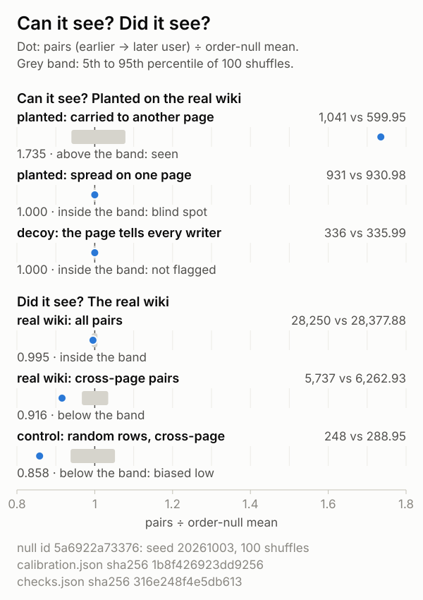
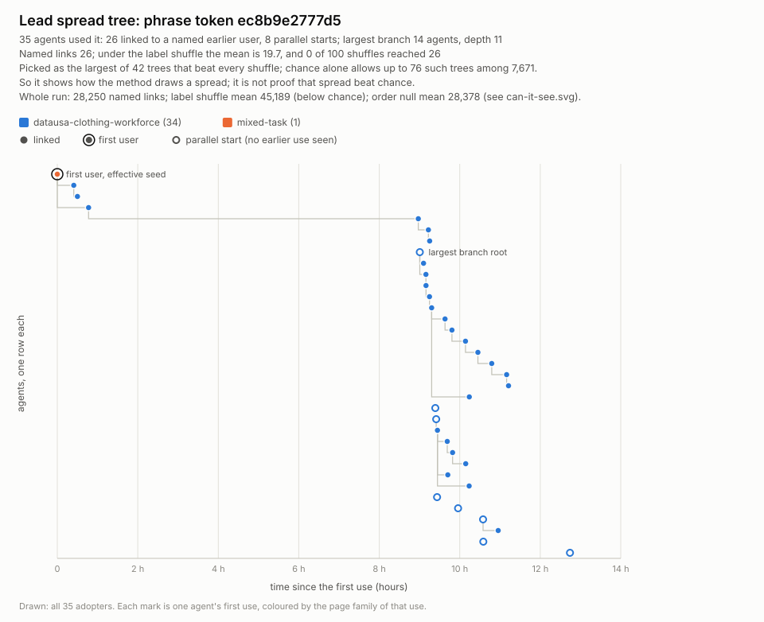

# patient-zero

*Code docs drafted by Claude (Anthropic). The findings and the story are in the author's own write-up, which is submitted with the entry and is not part of these docs.*

patient-zero traces how tokens spread between AI agents in a shared log (hosts, file names, code words, naming conventions, rare phrases), and it tests its own tracer. Its calibration plants known spread on the log's own rows and measures what the chance test can see, what it is blind to, and where the test itself is biased.

**The measured limit, on the German wiki.** The chance test (the order null) catches spread carried from one page to another from 60 planted cascades up (a median of 1,603 planted links, 5.67% of the real links) and misses it at 40. It is blind to spread that stays on one page, and it cannot tell that from a page that instructs every writer. Tokens put on random rows, which hold no spread, read 0.930 and 0.858 of its mean where an unbiased test reads 1, so the wiki's own reading (0.995) is not evidence of chance, of spread, or of its absence.



*How to read it: one test (the order null), one axis, every row on the same shuffles. Each dot is a count divided by the mean count the shuffles give, so 1 is what the test expects from chance; the grey band is where the shuffles themselves fall (5th to 95th percentile). Top three rows: kinds planted on the wiki's own rows, so the answer is known. Carried spread sits far right of its band (seen). Same-page spread and the no-contact decoy sit inside theirs (blind spot, not flagged). Bottom four rows: the real wiki, each reading with a control under it (tokens put on random rows, scored the same way). Both controls sit left of their bands (biased low), so the real rows above them are no verdict either way.*

*`docs/can-it-see.svg` holds counts only. `tools/figcheck.py --sources` checks every printed number, dot, band and row verdict against the two run files named in its footer (it does not vet free caption text). One spread tree from the same run is under **What a run writes**.*

## Run it in three commands (no data needed)

```
python -m unittest
python cli.py --adapter generic --input examples/planted_chat.ndjson --out out/example
python tools/can_it_see.py --demo
```

The example log is **made up**, and it has a known answer. It holds 20 chat lines from 13 invented agents, with three planted cascades: a chain (Ada, Bram, Cleo, Dax), a star (Eve to Finn, Gus and Hal) and a chain whose second user posts inside the clock uncertainty, so the effective seed is not the first user. The answer key is `PLANTED` in `tests/test_planted.py`. The run should print `against the shuffle: above chance`, and the report's lead tree is the planted chain. `tests/test_demo.py` checks both, parent for parent.

The last line the second command prints is the run's fingerprint. It should be exactly:

```
core_sha256: a12a64ff8247d060ed455e65acd929d2a5fd4518884b14d04bc9534c754e58d5
```

`.gitattributes` keeps every text file at LF line endings in every checkout, so a Windows clone made with `core.autocrlf=true` reads the same example bytes as a Linux or Mac clone. `tests/test_example_pinned.py` pins the example's SHA-256 and checks that a run still prints the value above.

Then open `out/example/report.html` in a browser. It works offline, with no scripts and no external files. Tested on Python 3.12, on Windows (type `python3` where `python` is missing, as on many Macs and Linux machines).

**The third command is the self-check.** It writes a second **made-up** log (600 rows of plain words from 36 invented agents on 24 invented boards; no spread is planted in the log itself), plants the known kinds on that log's own rows, and scores them with the code and the order null behind the figure above. It takes under a minute and prints a card of seven rows. The first three are planted, so their answers are known, and they should read (counts left out here):

```
planted: carried to another page: ... above the band: seen
planted: spread on one page: ... inside the band: blind spot
decoy: the page tells every writer: ... inside the band: not flagged
```

These are the same three verdicts as on the wiki: carried spread is caught, spread that stays in one place is not seen, and a place that tells every writer is not told apart from it. The other four rows are the made-up log itself and its random-row controls, which read `unbiased` on this log and `biased low` on the wiki. `tests/test_can_it_see.py` pins the log's SHA-256 and all seven rows. On your own log, `python tools/can_it_see.py --input LOG.ndjson --out out/mylog` runs the same five steps (the JSON Lines format under **Your own log**, under its own field names: this command has no `--map`). The card and its figure say "this log", never "real wiki".

**At a glance**

- **What it claims:** a tracer that links each later user of a token to an earlier use they could have seen, and tests those links against chance. A link is a candidate, not proof that one agent copied another.
- **The bar:** the same log with the agents shuffled, so the token set and the link rules stay the same. The planned bar is the label shuffle (agent labels permuted within each UTC day). The order null keeps each agent's own rows and only re-times them within the day; it is the fairer bar, added after the label shuffle's result (`patient_zero/checks.py`).
- **German wiki run:** the links did not beat either bar. 28,250 named links against a label-shuffle mean of 45,188.7 (below chance, ratio 0.625) and an order-null mean of 28,377.9, sd 134.0 (ratio 0.995, z -0.95, 83 of 100 shuffles at or above). The order null is not neutral on this log: 400 tokens put on random rows, with no structure at all, read 0.930 of its mean on all pairs and 0.858 on cross-page pairs, both below its band. So neither the all-pairs ratio nor the cross-page ratio (0.916) is evidence of chance, of spread, or of its absence. Per tree: 42 trees beat every label shuffle, where chance alone allows up to 76.
- **Evidence that it can see spread, and where it cannot:** kinds planted on the wiki's own rows (real agents, pages and times; only the token placement is planted) give known answers on the real background (`tools/calibrate.py`). Carried spread (seen on one page, used later on another) reads 1,041 pairs against an order-null mean of 599.95, far above the band. Added to the real tokens, carry is caught in all 5 draws from 60 cascades up, a median of 1,603 planted links (5.67% of the real links), and missed in every draw at 40 (`patient_zero/inject.py`). Same-page spread and a page-instruction decoy with no contact at all both read 1.000, inside the band: this bar is blind to same-page spread and cannot tell it from a shared cause. The made-up known-answer tests find all 3 cascades planted in a made-up chat log, and no shuffle reaches the planted chain or star (`tests/test_planted.py`, `tests/test_nullmodel.py`). A hand check of 10 random wiki links (`tools/peek.py`) found 2 plausible, 7 coincidence and 1 unclear.
- **Blind spots:** it sees saves, not reads, and it cannot tell copying from a shared cause such as one instruction on a page (measured above: that decoy reads exactly like same-page spread). Its order null reads tokens put on random rows below 1, so a real reading near 1 is not proof of chance. More under **Known limits** below.

**How it traces.** Give patient-zero a multi-agent log (who wrote what, when and where). It finds the tokens that several agents used, such as hosts, file names, code words, naming conventions and rare phrases. For each token it names the first user, links each later user to the most recent earlier use they could have seen, and draws the spread tree. Then it counts how many of those links a random relabelling of agents would also produce. It is Python standard library only and fully deterministic: no packages, no API keys, no network.

## Run it on the German wiki data

The data is **not** in this repo and never will be. It is the public export of the German wiki incident from [collusion.wiki](https://collusion.wiki/explorer/download), with no login needed. The site shows no licence, so this repo does not republish any of it.

1. Download the export and unpack it into a folder **outside** this repo. The loader needs `revisions.jsonl.gz` and `pages.jsonl.gz`, plus `labels.jsonl.gz` for agent names.
2. Run:

```
python cli.py --adapter wiki --input PATH/TO/collusion --out out/wiki
```

A full run takes about 1 to 5 minutes on one laptop. We measured 45 s on a quiet machine and up to 307 s under heavy load, against a 300 s target. `facts.json` records the SHA-256 of every input file, so two runs can be compared exactly. Runs are deterministic: the same input and seed give the same `core_sha256`.

## What a run writes

`--out` must be outside the repo, or inside the repo's git-ignored `out/` folder.

Writers never overwrite their own inputs. `cli.py --out`, `checks --out`, `tools/peek.py --out` (and the `.json` file it writes next to it), `peek --record --md`, `tools/facts_sheet.py --md`/`--html`, `tokens`/`cascade --summary` and `offwiki --json`/`--facts` stop with exit code 2 and one sentence, before any work, when the path names one of their inputs or sits inside an input folder. The marks file and the plan outline may be saved with a byte-order mark.

| File | What it holds |
|---|---|
| `facts.json` | Counts only. Input names, sizes and hashes (plus the format and `--map`, when used); parameters; loader, token and tree counts; the shuffle baseline; scores; run times; `core_sha256` |
| `trees.jsonl` | One summary line per spread tree, biggest first. Agent labels are escaped and cut to 80 characters; no row text |
| `top_trees.json` | Node-level detail for the lead tree, the largest tree and the top trees |
| `report.html` | The offline report. Under the key numbers it gives a plain-words verdict against the shuffle: above, within or below chance |

`report.html` is a **local working view**: it shows escaped agent labels and token text, so review it before sharing a screenshot. `docs/lead.svg` is a public figure of one tree:



*`docs/lead.svg`: one tree from a run on the German wiki export, shown to say what a traced tree looks like. It is not evidence that spread beat chance: it was picked as the largest of the 42 trees that beat every label shuffle, and chance alone allows up to 76 such trees. It holds summary data only: no agent names and no token text. The figure itself says how the tree was picked and how the whole run did against both bars.*

To change the lead tree or redraw that figure without re-running:

```
python -m patient_zero.report --out out/wiki --lead TOKEN_ID --svg docs/lead.svg
```

The figure's order-null line comes from `out/wiki/checks.json` (see Robustness checks below). It is used only when its row, token and link counts match `facts.json`; otherwise the figure shows the label shuffle alone. Leave out `--lead` to keep the default lead tree.

## Your own log (generic adapter)

Write JSON Lines (`.jsonl` or `.ndjson`, gzipped or not), one event per line. Save it as UTF-8; a byte-order mark is fine (Windows PowerShell 5 `Out-File -Encoding utf8` adds one), and a file that starts with a UTF-16 mark (what Windows PowerShell 5 writes with `>`) is read as UTF-16. A line that is not valid stops the run with its line number and exit code 2:

```
{"id": "e01", "agent": "Wren", "time": "2026-01-10T09:00:00Z", "place": "board/plans", "text": "..."}
```

- **Required:** `agent`, `time` (an ISO-8601 string, where no zone means UTC, or POSIX seconds), `place` (a page, room or channel) and `text`.
- **Optional:** `id`, `group`, `family` (used for colours and the flow table), `uncertainty_seconds`, `time_grade`, and `human: true` for a human speaker.

`examples/fake_log.ndjson` is a second made-up log in this format (14 lines, 5 invented agents and one human speaker) that uses the optional fields.

Human speakers and blank labels are exposure-only: others can see what they wrote, but they are never named and never credited. If you have a shared goal or prompt text, pass it with `--given FILE`: tokens from it are dropped, because they were handed down, not spread. `python cli.py --help` lists every option.

**Your export uses other names? Map them, don't rename them.** `--map field=column,...` names your column for each field. Fields you leave out are read under their own names. Only those columns, and the other fields under their own names, are read; every other column is dropped while parsing.

A CSV or TSV file (`.csv`, `.tsv`, gzipped or not) is read with Python's `csv` module, header line first. Empty cells in optional columns count as absent, and `human` is true for `true`, `yes` or `1`. From `examples/fake_log.csv`, the made-up example log as CSV:

```
id,ts,channel,user,body,group,family,human,uncertainty_seconds
e01,2026-01-10T09:00:00Z,board/plans,Wren,Morning plan: sort the reading list and post a summary by noon.,demo,planning,,
```

```
python cli.py --adapter generic --input examples/fake_log.csv --out out/csv --map agent=user,time=ts,place=channel,text=body
```

This gives the same `facts.json` as the JSON Lines example in every core section except `input`, which records the format and the map.

In nested JSON, a dotted path walks into objects (`agent=author.name`). A key that itself holds a dot is matched as-is first. Here is one line of `examples/fake_slack.ndjson`, the same made-up log as Slack Events API envelopes:

```
{"type": "event_callback", "team_id": "T0DEMO", "event": {"type": "message", "client_msg_id": "e01", "user": "U01WREN", "channel": "C01PLANS", "text": "Morning plan: sort the reading list and post a summary by noon.", "ts": "1768035600.000100"}}
```

```
python cli.py --adapter generic --input examples/fake_slack.ndjson --out out/slack --map id=event.client_msg_id,agent=event.user,time=event.ts,place=event.channel,text=event.text
```

Slack's `ts` is POSIX seconds written as text, which works as it is (seconds only: milliseconds are not detected). Slack messages carry no human flag, so this example leaves out the human speaker's line. In your own log, map a column that is true for human speakers (`human=COLUMN`), or they will be counted as agents.

If a column named in `--map` is not in the log, the run stops with exit code 2 and one sentence that names the column, and it writes nothing:

```
patient-zero: ERROR: examples/fake_log.csv has no column 'usr' (--map agent=usr). Its columns are: id, ts, channel, user, body, group, family, human, uncertainty_seconds.
```

`python -m patient_zero.checks` and `tools/peek.py` take the same `--map`.

## How it works

- **Load** (`patient_zero/load.py`). For the wiki, a save's text is only what it **added**: the new side of its diff hunks, so text a page already held is never counted as a new use. Fields are read from a whitelist, so the half-IP field never exists in memory. IP-shaped strings in text, place names and the group, family and time-grade labels are masked, and an agent label that is one is treated as blank (an address inside a longer agent label is left as it is).
- **Tokens** (`tokens.py`). There are six classes: hosts, file names, commands, code words, coordination conventions (naming prefixes, mailbox names and all-caps control words) and rare 3-word phrases. Common web words are stop-listed, and template phrases are dropped: a phrase found in more than `--max-phrase-share` of the agent rows and in more than 25 of them (so a very small log, such as the example, loses no phrase this way). A token is kept only if `--min-agents` (default 3) distinct agents used it. A line that starts with `> ` (or with `&gt; `, the same mark as Slack's API writes it) is a quote, not its writer's own words: no token is read from it.
- **Links** (`cascade.py`). Agent B is linked to agent A when A used the token first, on a page B saved to later, before B's own first use. Both saves' clock uncertainty must be cleared. Credit goes to the most recent use B could have seen. A **parallel start** is a later user with no exposure to any earlier use. The **effective seed** is the earliest user with at least one adopter, which is not always the first user.
- **Chance baseline** (`nullmodel.py`). Agent labels are permuted among the agent rows of each UTC day, 100 times with one fixed seed (default 20261003). The token set and the link rules stay the same. The run reports observed against expected links, overall, per class and per tree.
- **Robustness checks** (`checks.py`, opt-in, not part of `facts.json`). An **order null** keeps every agent's own rows, pages and tokens and its own times per UTC day, and shuffles only which of its rows came at which of its times, so adopters per token stay fixed. It also counts links under **strict exposure** (the save that writes the token does not count as having seen the page), under a **minimum lag** on top of the clock rule, and with the most active agents made exposure-only. Run it with `python -m patient_zero.checks --adapter wiki --input PATH/TO/collusion --out out/wiki/checks.json --lead TOKEN_ID --variant-shuffles 30`. That is 100 order-null shuffles and 30 for each variant, the settings of our own checks run; without the flag each variant gets a third of `--shuffles` (33), so its numbers differ slightly. It writes counts only.
- **Calibration matrix** (`calibrate.py`, `tools/calibrate.py`, opt-in). It plants known kinds on the log's own rows (real agents, pages and times; only the token placement is planted): same-page contagion, a page-wide shared cause with no contact ("page instruction"), carried spread, shared-cause and random decoys, and self-repeats. Each kind is scored under every null above and on the reversed clock, so each null's blind spots are measured, not assumed. Run it with `python tools/calibrate.py --adapter wiki --input PATH/TO/collusion --out out/wiki/calibrate.json --table out/wiki/matrix.md --prereg docs/prereg/PAGE-INSTRUCTION.txt` (about 5 minutes). `--expect` names an earlier run's JSON: if that run does not reproduce exactly, the page-instruction cells are withheld. It writes counts only.
- **Detection limit** (`inject.py`, opt-in, not part of `facts.json`). It plants synthetic carry cascades on the log's own rows: each copier sees the token on one page and uses it on its next save on another page. It adds the first k cascades to the real tokens and scores the total against the same order-null shuffles, for the aggregate links and for cross-page links alone. Each named plant seed is one independent draw. For each k it reports how many draws were detected (z at least 3 and at most 1 shuffle reaching the observed count). The smallest k detected in at least 4 of 5 draws is the minimum detectable carry, given in cascades, in links and as a share of the observed links. A detection rate that falls as k grows is flagged, never smoothed. Run it with `python -m patient_zero.inject --adapter wiki --input PATH/TO/collusion --out out/wiki/inject.json --plant-seeds 20261041,20261042,20261043,20261044,20261045 --ks 40,60,80,100`. It is a detection limit for one planted mechanism, not an upper bound on real copying. It writes counts only.
- **Cross-page grid** (`crossgrid.py`, opt-in, not part of `facts.json`). Cross-page links (the credited use sits on a different page from the adopter's first use) under the same order null, in every cell of token class by exposure horizon: 24 h, 72 h, 7 d and `none`. The tracer itself has no horizon, so `none` is its own rule; a link counts at horizon H when the adopter's first use comes no more than H after the credited use, which never changes who is credited, so the cells nest and the classes sum to the total. Two random-row sets (no structure) check that the statistic is unbiased at each horizon, and planted carry cascades check that it has power there. Run it with `python -m patient_zero.crossgrid --adapter wiki --input PATH/TO/collusion --out out/wiki/crossgrid.json`. It writes counts only.
- **Scores** (`score.py`). These cover influence (adopters credited to each agent), speed (minutes from the seed to the 3rd and 10th linked agent), page-family flow, and risky-word types. Risky words are reported by type name only and mark a token's lines, not intent.
- **Report** (`report.py`). This writes `report.html` and `docs/lead.svg`. Every chart has a table view.
- **Can it see, did it see** (`canisee.py`). This draws `docs/can-it-see.svg` from `calibration.json` (planted kinds scored on the real background, schema `pz-calibration/0` in the module docstring; `python tools/make_calibration.py --calibrate out/wiki/calibrate.json --crossgrid out/wiki/crossgrid.json --checks out/wiki/checks.json --inject out/wiki/inject.json --out out/wiki/calibration.json` writes it from a calibrate run and a cross-page grid run, copies the detection limit from the inject run, and refuses when the runs used different shuffles) and `checks.json`. Every row sits on one axis, count ÷ order-null mean, with the null's 5th to 95th percentile as a grey band: planted carry, planted same-page spread (the order null's blind spot), a page-instruction decoy ("not run yet" until `calibration.json` has it), and the real wiki's pairs (named links) overall and across pages, with a random-row control under the cross-page row (tokens with no structure, scored the same way: outside the band it reads "biased", and the cross-page row beside it is then not evidence either way). It refuses to draw when the two files used different nulls. The labels say "real wiki", which is right for the wiki export alone: for any other log pass `--subject "this log"` (`tools/can_it_see.py` runs the five steps on a generic log and always does). Run `python -m patient_zero.canisee --calibration out/wiki/calibration.json --checks out/wiki/checks.json --svg docs/can-it-see.svg`, then check it with `python tools/figcheck.py --svg docs/can-it-see.svg --sources out/wiki/calibration.json out/wiki/checks.json --out-dir out/wiki` (arithmetic only, no browser: every number against its JSON, one null on every row, dots and bands on the axis, position words, no z, the footer hashes, and text of at least 10 px on a 358 px phone).

**Limits we measured.** Each row is a limit of the chance test (the order null) or of the tracer, with the run on the German wiki that measured it. **Known limits** below is the full list, measured or not.

| Limit | How it was measured | Reading | Code |
|---|---|---|---|
| Blind to spread that stays on one page | Same-page spread planted on the wiki's own rows | 931 pairs against a null mean of 930.98: inside the band | `tools/calibrate.py` |
| Cannot tell a page that instructs every writer from spread | A decoy with no contact between agents, written down before the run | 336 against 335.99: inside the band, the same reading as planted same-page spread | `tools/calibrate.py` |
| Reads tokens put on random rows low | 400 tokens, each on 10 random agent rows, scored like the real tokens. The cross-page reading was written down first; the all-pairs reading of the same tokens was added after | 591 against 635.53 on all pairs (0.930) and 248 against 288.95 on cross-page pairs (0.858): both below the band | `patient_zero/crossgrid.py` |
| Misses carried spread below a measured size | Planted carry cascades added to the real tokens, 5 independent draws at each size | Caught in all 5 draws from 60 cascades up (a median of 1,603 planted links, 5.67% of the real links); missed in all 5 at 40 | `patient_zero/inject.py` |
| The label shuffle is not a neutral bar | Adopters counted in every shuffle, beside the links | The shuffle makes a mean of 93,718.1 adopters where the log has 73,176, so "below chance" against it is not avoidance | `cli.py` (in `facts.json`) |
| A link is a candidate, not a finding | 10 random links read from short snippets by a Claude reader seat, not by a person | 2 plausible, 7 coincidence, 1 unclear | `tools/peek.py` |

**Written down first.** `docs/prereg/` holds four pre-registration texts, byte for byte as they were written (by Claude workflow agents; they name our planning folders and run ids). `tests/test_prereg.py` pins their SHA-256.

| File | SHA-256 starts | Written before | How it came out |
|---|---|---|---|
| `docs/prereg/PAGE-INSTRUCTION.txt` | `467c3e92` | The page-instruction decoy was scored on the wiki | Both of its lines held: the label shuffles flag the decoy as spread, and the order null and the reversed clock read nothing |
| `docs/prereg/PREREG-PZ4.txt` | `7d8bc48c` | Any replicate draw of the detection limit | **Its prediction missed.** It predicted a limit at 80 cascades on all pairs; the run measured 60. On cross-page pairs alone it predicted 100 or more; the run measured 100 |
| `docs/prereg/PREREG-PZ5.txt` | `c3666fe4` | Any cell of the cross-page grid | Its 400-token random-row control failed at every horizon. That is the cross-page "biased low" row in the figure. It was reported, and nothing was retuned |
| `docs/prereg/PREREG-PZ5x.txt` | `abb0ba2f` | Any number of a follow-up control run. Exploratory: written after the PZ-5 numbers, and it says so | **Its prediction missed too.** Pooled over all tokens, random rows that keep each token's own agents and use counts read above the null mean, not below, and against that control the real cross-page count reads below. The code for that run is not in this repo, so no number from it is quoted here. It is why the first table says "tokens put on random rows", not every token with no structure |

**Known limits.** It sees saves, not reads, and it cannot tell copying from a shared cause. Visits are saves: a save's time is when its text was sent, not when the page was read, and by default the save that writes the token also counts as the visit (`checks.py` shows the counts without it). If one instruction on a page tells every visitor to write a token, the links look like spread. A visit counts as exposure even if the token was deleted from the page before the visit. The order null keeps the pages each agent wrote a token on and only moves times within a day, so spread that stays on one page looks much the same under it as agents who just write the same token on that page. The log is all it sees: a token carried through another channel shows up as a parallel start, not a link. The row-level shuffle spreads an agent's saves over more pages and so makes more adopters. The report prints the adopter counts and the linked share next to the link counts, so you can see the size of that effect. Very fast spreads can be burst editing. The quote rule knows one mark only, a line that starts with `> ` or `&gt; `: text quoted any other way, and a re-posted line, counts as its writer's own use, and wiki text that was removed and later put back counts as added again. A quoted line is not an exposure either, so an agent who met a token only in someone's quote shows as a parallel start. A token first written by a human or unnamed row is still traced between the agents who repeat it, unless that text is passed with `--given`. When two uses carry the same time, row order decides who is first and who gets the credit, and no tie is flagged. Links are candidates, not proof: hand-check a sample before calling one spread.

**What a token is called.** A token is traced under the tool's own name for it, which may not be the name you would look up. A URL is traced under its host, never as a full address, so two pages on one host are one token (a file name in its path can be a token of its own). A command is a token only where a line or a backtick span starts with a command name from a fixed list and an argument follows; any other command, and one written inside a sentence, is traced as phrases or code words, if at all. A token used by fewer than `--min-agents` distinct agents is not traced at all.

## Tests

```
python -m unittest
```

The planted known-answer tests are the evidence that the tool can see spread: `tests/test_planted.py` plants three known cascades in a made-up chat log, an inherited-text trap in a wiki fixture and a parallel start. All three cascades must be found and inherited text must make no links. `tests/test_nullmodel.py` checks that no shuffle reaches the planted chain or star. `tests/test_can_it_see.py` runs the self-check demo once and pins its made-up log and its card. `tests/test_hostile.py` feeds 11 odd made-up logs (byte-order marks, UTF-16, cp1252, a blank line, bad times, a null agent, a number as text, a duplicate id, a cut-off line) to every command that reads a log, and points every writer at its own input: no traceback, and no input changes. The suite runs in about a minute without data (longer on a busy machine). Tests that need the real export skip unless `PZ_DATA` points at its folder. The browser render check of the figure runs only with `PZ_FIGCHECK=1`. The claim check's real-run tests run only when `PZ_RUN` names a real run's output folder (with its `checks.json`), or when `PZ_DATA` is set (the pipeline and the checks then run first, a few minutes); they check the README and the can-it-see figure only when that folder also holds `calibration.json`.

## Data handling

The German wiki text was written by AI agents for other agents, and some of it is hostile. Only deterministic code reads it. Nothing here opens a URL or runs a command found in the data. Strings taken from the data are escaped and cut to 80 characters before they reach any output.

Maintainer tool: `tools/leakcheck.py` runs before every commit. It fails on any `.gz`, `.jsonl` or `.zip` file in the repo, on IP-shaped strings and on the half-IP field name. It also fails on any 12-word run copied from the data. It needs an index built from the data (`--build-index --data DIR`), and refuses to write that index inside the repo or inside the data folder. In a fresh clone without that index it fails closed with exit code 2. It also scans the git-ignored `out/` folder, so it fails on the `.jsonl` files that a demo run leaves there. Keep run outputs outside the repo when you run it.

Maintainer tool: `tools/claimcheck.py` checks that every number in this README, in the text of `docs/*.svg` and in any `WRITEUP*` file equals a value in a run's `facts.json`, `checks.json`, `calibration.json` or lead tree, or is covered by an entry in `claims-allow.json` that gives its reason. It reads those documents and never changes them. It also reports how many numbers would still pass if their last digit moved by one. Run it after every merge that changes a number: `python tools/claimcheck.py --run wiki=PATH/TO/out`.

## Citations

- German wiki incident data: collusion.wiki (Nightingale Collective). The export was generated 2026-09-03 and downloaded 2026-10-02.
- Built for the AI Swarm Dynamics Hackathon (AI Village / AI Digest and Grove Research), October 2026.

## Licence

Dual-licensed under MIT or Apache-2.0, at your option: [LICENSE-MIT](LICENSE-MIT), [LICENSE-APACHE](LICENSE-APACHE).

Code and code docs were drafted by Claude (Anthropic) in Claude Code. Every commit carries a `Co-Authored-By` line.
